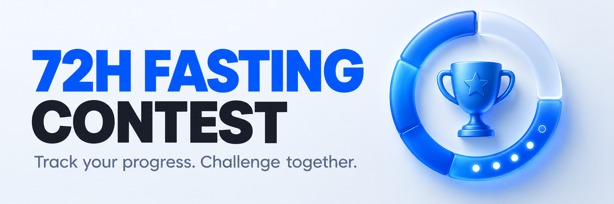

# 72H Fasting Contest

**Version 2.0** · iOS build 12 · Android version code 6

A safety-conscious iPhone and Android app for tracking a 72-hour fasting challenge, celebrating milestones, and joining friendly global or private contests.

Built for the **OpenAI Build Week — Apps for Your Life** category.

> [!IMPORTANT]
> 72H Fasting Contest is a tracking and motivation tool, not a medical device. It does not provide medical advice, diagnosis, or treatment. Fasting may not be appropriate for everyone. Consult a qualified healthcare professional before fasting—especially if you have a medical condition, are pregnant, are under 18, or take medication—and stop if you feel unwell.

## Why it exists

A 72-hour goal can feel abstract when viewed as one long countdown. This app breaks it into visible milestones, adds optional social accountability, and keeps safety information present throughout the experience. Users can participate anonymously without creating an email-and-password account.

## Features

- Guided onboarding with an explicit fasting-safety agreement.
- A live 72-hour timer with progress, status, and milestone tracking.
- Milestones at 12, 24, 36, 48, 60, and 72 hours.
- Local reminders and milestone notifications controlled by the user.
- Global and weekly leaderboards backed by Cloud Firestore.
- Private contests with invite codes for friends.
- Anonymous Firebase Authentication—no email, phone number, or password required.
- History, personal statistics, streaks, rankings, and achievement badges.
- Offline-friendly local persistence with Firebase sync for connected features.
- Explicit consent before leaderboard profile and fasting-session data are uploaded.
- No advertisements, tracking across apps, or third-party analytics SDKs.

## App Store upload assets

[Header and Search Results files with exact Apple dimensions](docs/app-store/README.md). Use these for App Store Connect; the GitHub banner above has a different aspect ratio. All 15 device screenshots are exported without an alpha channel.

## Screenshots

Native captures from the signed SwiftUI app on iPhone 18 Pro, iPad Pro 13-inch (M5), and iPhone Duo.

| iPhone 18 Pro | iPad Pro 13-inch | iPhone Duo |
| --- | --- | --- |
|  |  |  |
|  |  |  |

[Full screenshot gallery](docs/screenshots/README.md) · [Verification and remaining limits](docs/verification.md)

## Architecture and tech stack

72H Fasting Contest is a native SwiftUI application with a protocol-backed data layer that supports Firebase and a local/offline fallback.

- **iOS UI:** SwiftUI, native navigation and controls, SF Symbols
- **Android UI:** Kotlin and Jetpack Compose with Material 3
- **State:** `AppViewModel` shared through SwiftUI's environment
- **Models:** Codable value types for profiles, sessions, contests, badges, and preferences
- **Backend abstraction:** `ContestBackend` protocol with Firebase and offline implementations
- **Cloud:** Firebase Anonymous Authentication and Cloud Firestore
- **Realtime data:** Firestore snapshot listeners for leaderboards
- **Local data:** Codable snapshots stored on device for caching and offline use
- **Notifications:** UserNotifications for local reminders and milestones
- **Platforms:** iOS 17 or later and Android 8.0 (API 26) or later
- **Dependencies:** Firebase iOS SDK through Swift Package Manager

```text
72H Fasting Contest/
├── App/          Application entry point and Firebase bootstrap
├── Models/       Profiles, fasting sessions, contests, badges, and stats
├── ViewModels/   App state, timer logic, milestones, and orchestration
├── Services/     Firebase, persistence, authentication, and notifications
├── Views/        Onboarding, challenge, leaderboards, contests, and settings
├── Components/   Shared visual components
└── Resources/    Assets and Firebase client configuration
```

Firestore security rules validate ownership, permitted fields, state transitions, maximum elapsed time, contest membership changes, and badge writes. Official challenge timing uses server timestamps so clients cannot complete a 72-hour session early by changing a local clock.

## Requirements

- macOS with Xcode 15 or later
- iOS 17 or later simulator or physical device
- Internet access for Firebase authentication, leaderboards, contests, and sync
- A Firebase project only if replacing the included Build Week configuration

## Setup and run

1. Clone the repository:

   ```sh
   git clone https://github.com/powerusa/72h-fasting-contest.git
   cd 72h-fasting-contest
   ```

2. Open `72H Fasting Contest.xcodeproj` in Xcode.
3. Allow Xcode to resolve the Firebase Swift packages.
4. Select the `72H Fasting Contest` scheme and an iOS 17+ simulator.
5. Press **Run** (`⌘R`).

The repository includes a Firebase client configuration for judging. To connect a different Firebase project, follow [FIREBASE_SETUP.md](FIREBASE_SETUP.md), enable Anonymous Authentication, create Cloud Firestore, and deploy [firestore.rules](firestore.rules).

Command-line build:

```sh
xcodebuild \
  -project "72H Fasting Contest.xcodeproj" \
  -scheme "72H Fasting Contest" \
  -sdk iphonesimulator \
  -configuration Debug \
  build
```

Keep simulator code signing enabled: Firebase Authentication uses the simulator keychain. If signing reports Finder metadata on build products in an iCloud-synced folder, use a derived-data directory under `/private/tmp`.

### Android setup and run

The Android application lives in `androidApp/` and is registered in the same Firebase project as the iOS application. Both clients use Firebase Anonymous Authentication and the same `users`, `fastingSessions`, `contests`, and `badges` collections. That makes Android and iPhone participants visible in one live leaderboard and allows the same private contest invite code to be used on either platform.

1. Open the repository root in Android Studio.
2. If Android Studio asks for a Gradle JVM, choose **Use JVM 21** (or select JDK 21 in Gradle settings), then allow Gradle to sync. Gradle 8.13 in this project does not run with Java 25.
3. Select the `androidApp` run configuration and an Android 8.0+ device or emulator.
4. Press **Run**.

Command-line Android build:

```sh
JAVA_HOME="$(/usr/libexec/java_home -v 21)" \
  ./gradlew :androidApp:assembleDebug
```

## Manual testing guide

Run the [Swift regressions](tests/ios/README.md) and [Firestore emulator tests](tests/firestore/README.md), then use this acceptance pass for the Build Week version:

1. Launch the app and complete onboarding; confirm the safety agreement is required.
2. Create a display profile and review the leaderboard data-sharing disclosure.
3. Start a fast and confirm the timer, progress, current status, and local history update.
4. Stop the fast and confirm the session is locked and retained in History.
5. Enable notification reminders and verify the selected preferences persist after relaunch.
6. Open global and weekly leaderboards and confirm Firebase data loads.
7. Create a private contest, copy its invite code, and join it from a second simulator/device.
8. Relaunch with the network unavailable and confirm cached/local screens remain usable.
9. Inspect safety copy, light/dark mode, and a larger Dynamic Type size.

Testing a real 72-hour completion requires elapsed server time; the Firestore rules intentionally reject early completion. Judges can evaluate the active/stopped flows, milestones, UI, history, contests, and leaderboard behavior without waiting 72 hours.

## Automated regression checks

```sh
python3 tests/ios/run.py
cd tests/firestore
pnpm install --frozen-lockfile --ignore-scripts
pnpm run emulator-test
```

The rules tests use a local demo project. Production rule deployment requires a separate authenticated Firebase operation. See [verification notes](docs/verification.md).

## How Codex and GPT-5.6 were used

Codex powered by GPT-5.6 served as an AI pair programmer during Build Week. It helped:

- translate the product concept into SwiftUI screens and reusable components;
- design the Codable domain models and central app-state workflow;
- implement Firebase Anonymous Authentication, Firestore persistence, and realtime leaderboard listeners;
- create the backend protocol and offline implementation;
- reason through timer state, milestones, contest membership, and server-validated 72-hour completion;
- improve privacy disclosures, consent prompts, fasting-safety language, and Firestore rules;
- iterate on build issues, simulator behavior, UI accessibility, dark mode, and testing instructions;
- inspect the repository for exposed secrets and prepare the final Build Week documentation.

The developer chose the product direction, reviewed the generated code, configured the Firebase project, tested the app, and iterated with Codex. The shipped app does not call OpenAI APIs at runtime and sends no data to OpenAI.

## Privacy, security, and medical safety

- Users authenticate anonymously; the app does not request an email address or password.
- Leaderboard upload requires an explicit in-app disclosure and consent.
- Cloud data is limited to the profile, session, contest, and achievement fields needed by the app.
- Firestore writes are constrained by the checked-in security rules.
- Local notifications can be disabled at any time.
- The app does not use HealthKit, collect medical records, or promise health outcomes.
- Firebase configuration values identify the client project and are protected by authentication, restrictive Firestore rules, and Google Cloud API-key restrictions—not by treating the client plist as a server secret.

See the full [Privacy Policy](PRIVACY_POLICY.md).

## Current limitations

- Online social features require Firebase and an internet connection.
- Anonymous accounts may not be recoverable after app deletion unless Firebase preserves the installation identity.
- A full completion cannot be accelerated for testing because server-side rules enforce 72 elapsed hours.
- Regression scripts cover iOS models/rankings and Firestore rules. An Xcode UI test target has not yet been added.

## Build Week submission

- Category: **Apps for Your Life**
- Source repository: <https://github.com/powerusa/72h-fasting-contest>
- Demo video: <https://youtube.com/shorts/GZdXyhyRXrs>
- Codex `/feedback` Session ID: provided with the contest submission
- Devpost: <https://devpost.com/software/72hour-fasting-clock>

## License

Released under the [MIT License](LICENSE).
