# Screenshot gallery

Native PNG captures from the signed SwiftUI simulator app, October 17, 2026. The header is generated branding artwork; these screenshots are real app captures, without composited UI or fabricated results.

The iPhone uses its existing profile/session. iPad and Duo use local preview profiles without uploading profile or fasting-session fixtures. The global leaderboard is read from Firebase. Private contests and statistics show the actual state of each installation.

## iPhone 18 Pro · iOS 27.0

| Screen | Native pixels | Preview |
| --- | --- | --- |
| Challenge | 1206 × 2622 | <a href="iphone/01-challenge.png">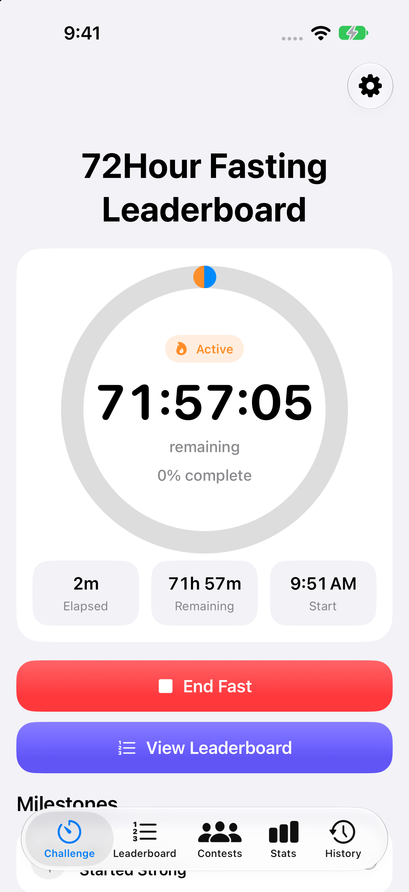</a> |
| Leaderboard | 1206 × 2622 | <a href="iphone/02-leaderboard.png">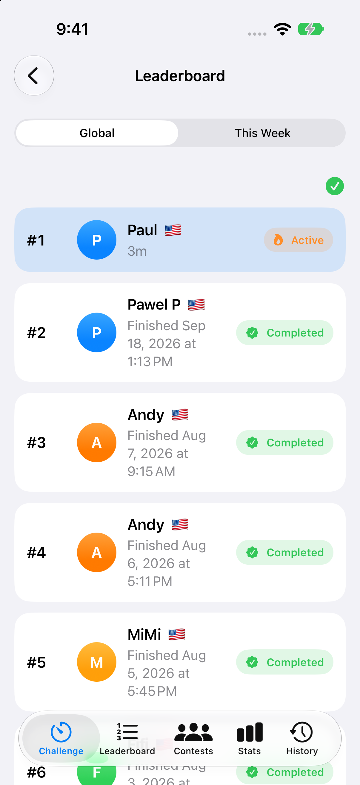</a> |
| Contests | 1206 × 2622 | <a href="iphone/03-contests.png">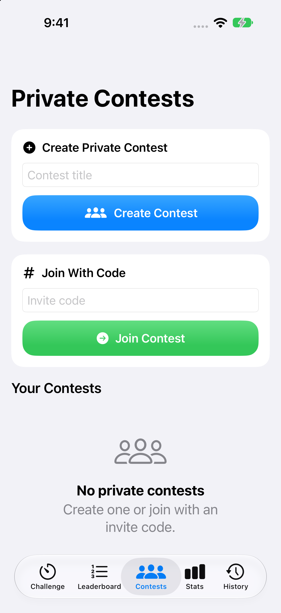</a> |
| Stats | 1206 × 2622 | <a href="iphone/04-stats.png">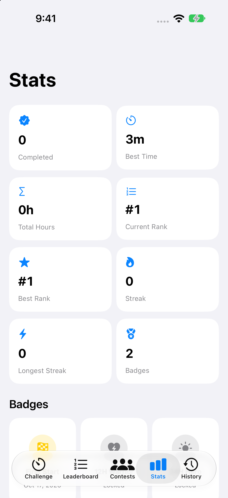</a> |

## iPad Pro 13-inch (M5) · iPadOS 27.0

| Screen | Native pixels | Preview |
| --- | --- | --- |
| Challenge | 2064 × 2752 | <a href="ipad/01-challenge.png">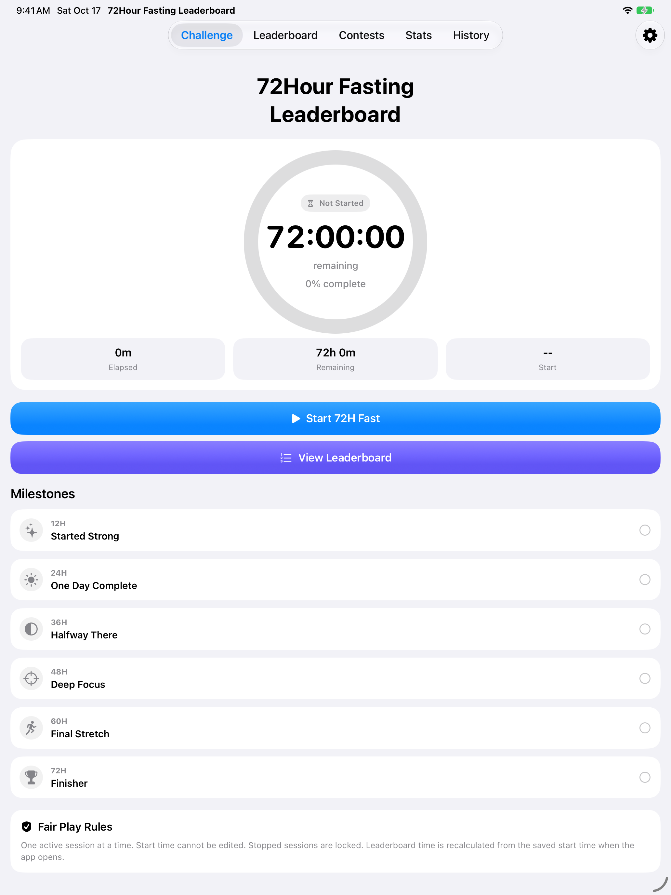</a> |
| Leaderboard | 2064 × 2752 | <a href="ipad/02-leaderboard.png">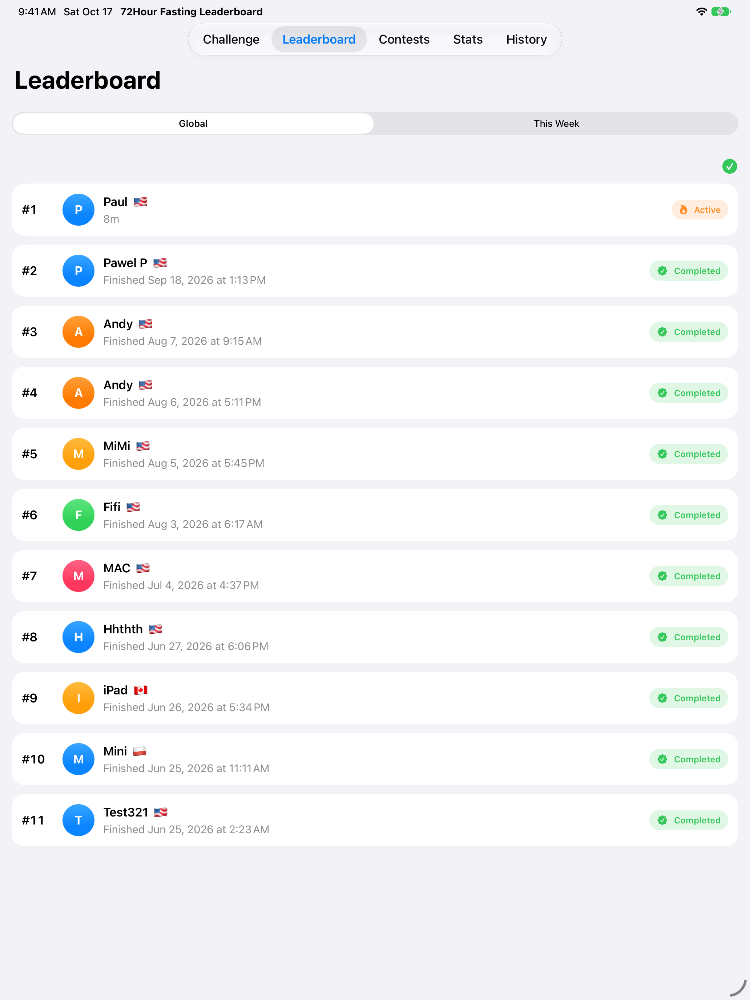</a> |
| Contests | 2064 × 2752 | <a href="ipad/03-contests.png">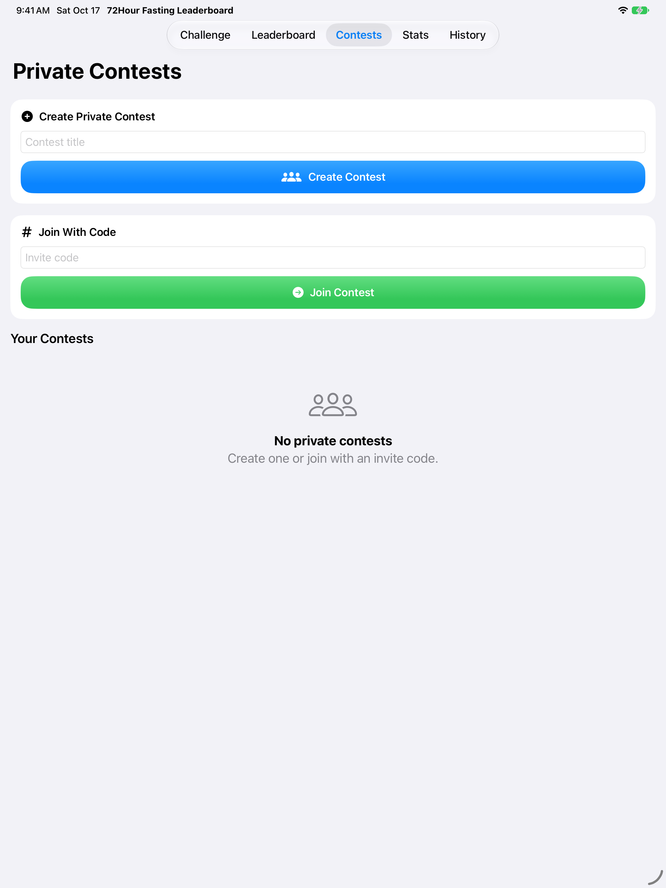</a> |
| Stats | 2064 × 2752 | <a href="ipad/04-stats.png">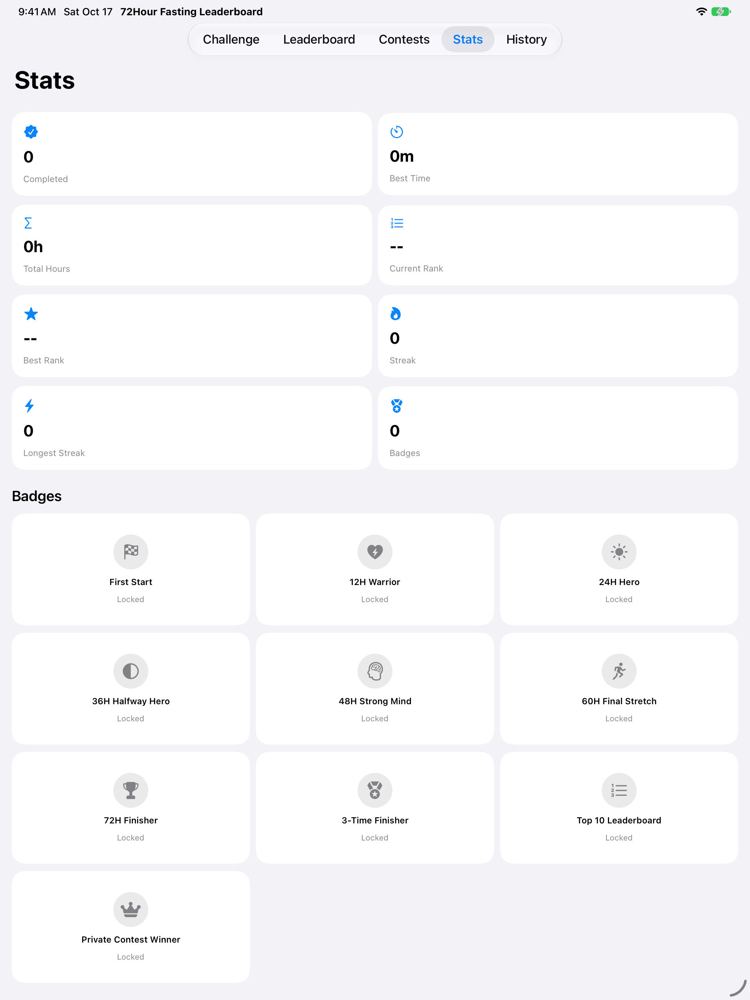</a> |
| Onboarding | 2064 × 2752 | <a href="ipad/05-onboarding.png">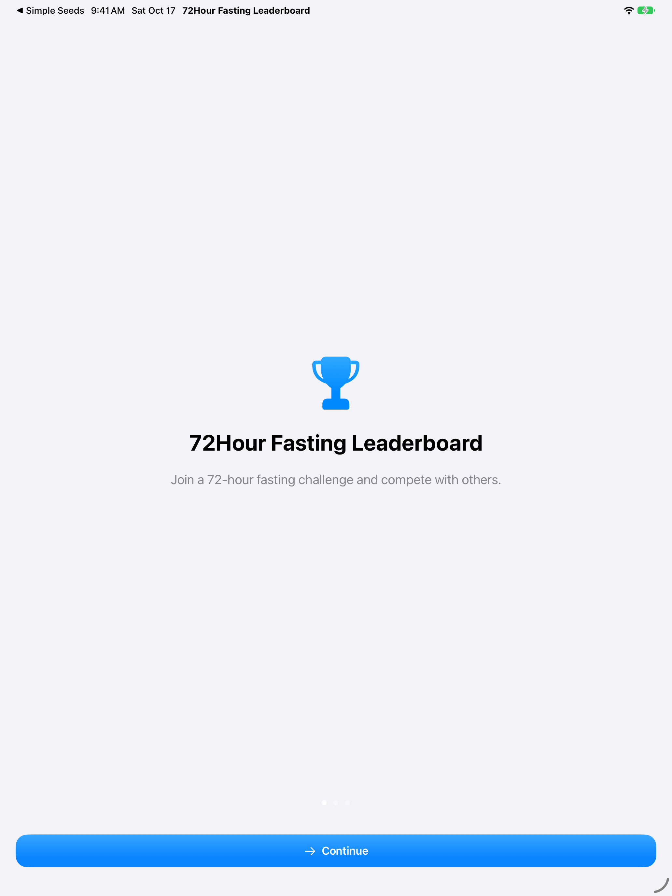</a> |

## iPhone Duo · iOS 27.1

| Screen | Native pixels | Preview |
| --- | --- | --- |
| Challenge | 2007 × 2853 | <a href="duo/01-challenge.png">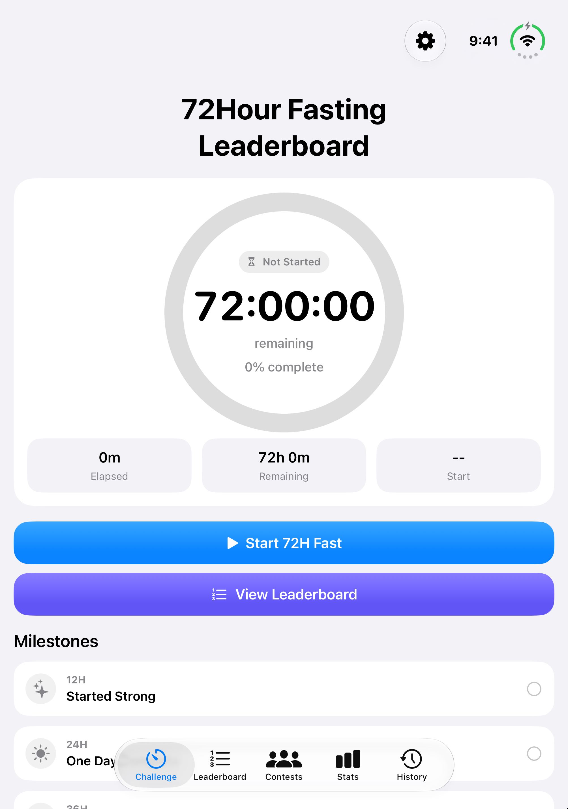</a> |
| Leaderboard | 2007 × 2853 | <a href="duo/02-leaderboard.png">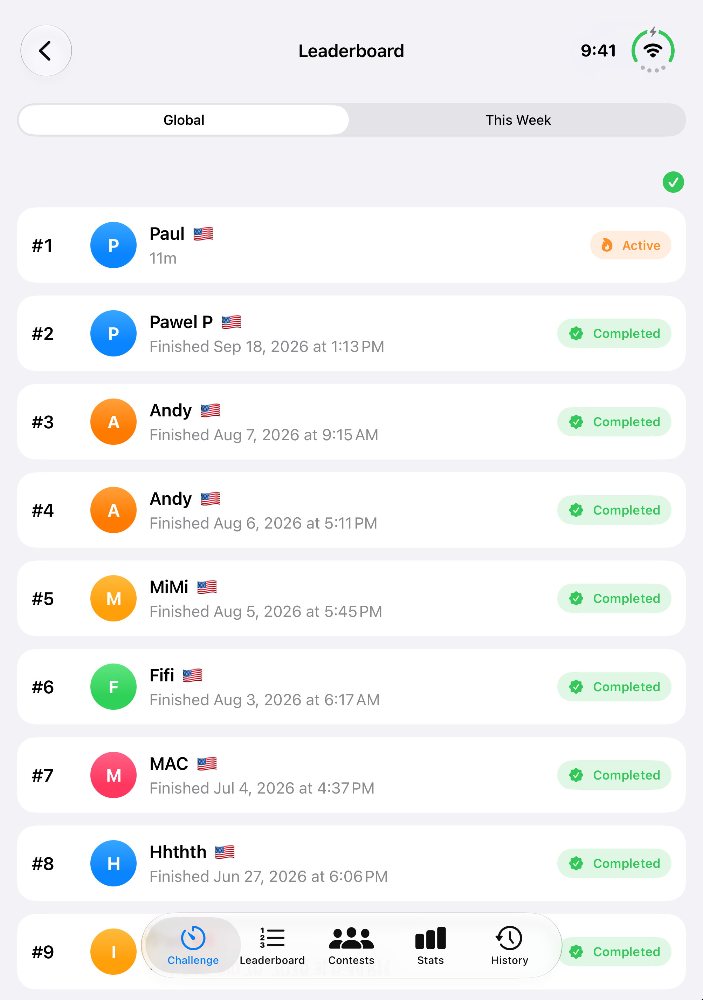</a> |
| Contests | 2007 × 2853 | <a href="duo/03-contests.png">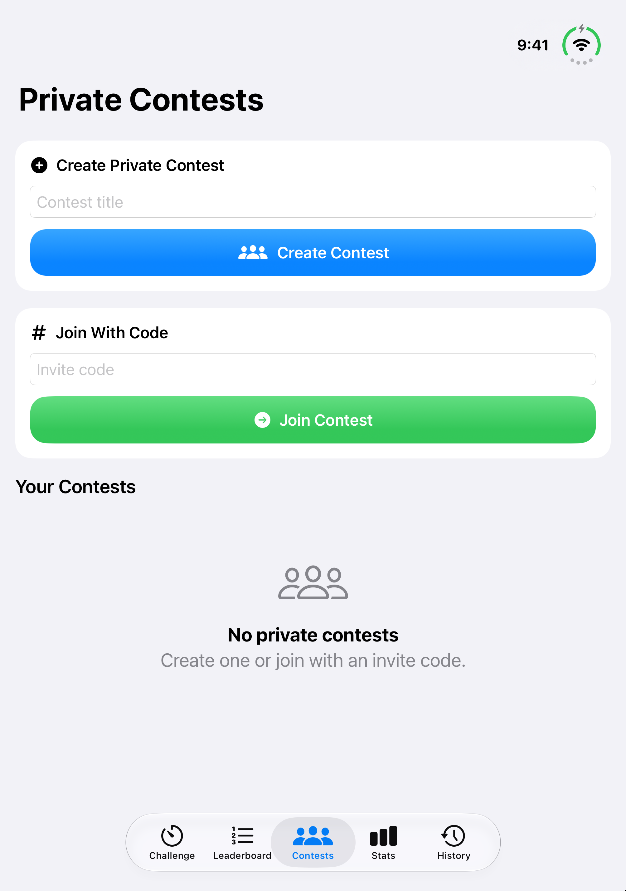</a> |
| Stats | 2007 × 2853 | <a href="duo/04-stats.png">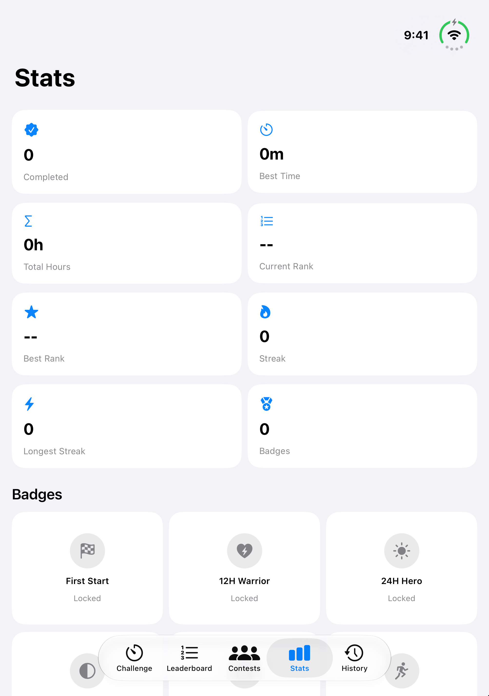</a> |
| Challenge Closed | 1398 × 2034 | <a href="duo/05-challenge-closed.png">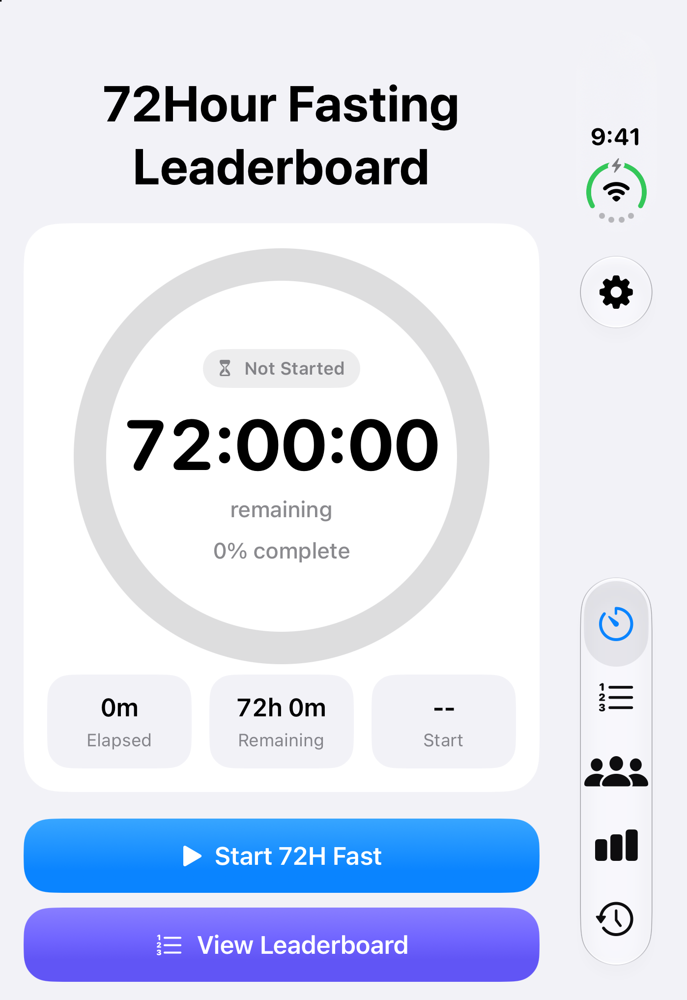</a> |
| Challenge Open Landscape | 2853 × 2007 | <a href="duo/06-challenge-open-landscape.png">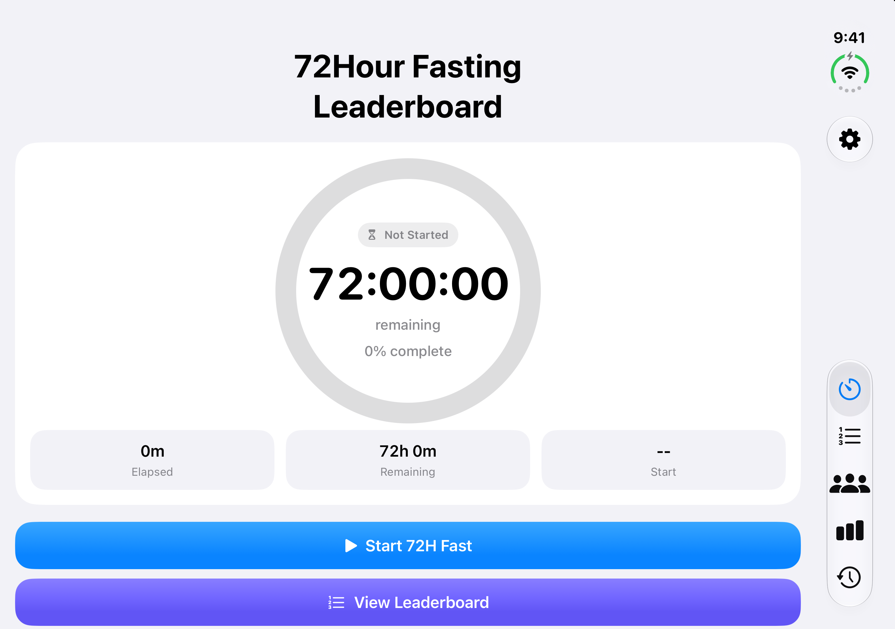</a> |

Duo includes the inner display in portrait and landscape, plus the outer display while folded. All files retain their native dimensions. See `manifest.json` for dimensions and SHA-256 hashes.
